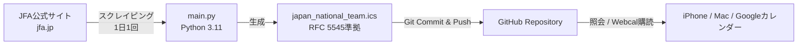

# サッカー日本代表 試合日程カレンダー（iCal自動配信）

JFA（公益財団法人 日本サッカー協会）公式サイトから「サッカー日本代表（SAMURAI BLUE）」の最新試合日程を自動取得し、iCalendar形式（`.ics`）で配信・自動更新するリポジトリです。

iPhone（iOS）やMac、Googleカレンダーなどのカレンダーアプリに「照会（購読）」登録することで、**日本代表の最新試合日程やキックオフ時間、対戦相手、会場、試合結果が常に自動で同期**されます。

---

## 🌟 特徴

- **常に最新情報を自動反映**: GitHub Actionsにより毎日1回（日本時間 深夜4:00）自動でJFA公式サイトを巡回・更新
- **正確なJST（日本時間）対応**: タイムゾーン `Asia/Tokyo` を明示し、時差ボケのない正確なスケジュールを配信
- **キックオフ時間・会場・結果も網羅**:
  - キックオフ時間が判明している試合は正確な開始〜終了時刻を設定
  - 未定の試合は「終日イベント」として仮登録され、時間発表後に自動更新
  - 会場スタジアム名、対戦カード、スコア結果、JFA公式詳細ページURLも記載
- **相手サーバーへの負荷軽減**: リクエスト間隔（1秒インターバル）やアクセス頻度（1日1回）を厳密に制限し、適切なUser-Agentを設定したセーフ運用

---

## 📱 iPhone（iOSカレンダー）での登録手順（照会カレンダー追加）

iPhoneの標準「カレンダー」アプリに登録すると、予定が自動更新されます。

### 1. 購読用URL（Raw URL）をコピー

以下のURLの `<ユーザー名>` と `<リポジトリ名>` を、ご自身のGitHub環境に合わせて書き換えてコピーしてください。

```text
https://raw.githubusercontent.com/<ユーザー名>/<リポジトリ名>/main/japan_national_team.ics
```

> **Tips**: `https://` を `webcal://` に変更したURL（例: `webcal://raw.githubusercontent.com/...`）をiPhoneのSafariで開くだけで、ワンタップでカレンダー追加ダイアログを起動することも可能です。

### 2. iPhoneの設定手順

1. iPhoneの **「設定」** アプリを開きます。
2. **「カレンダー」** をタップします。  
   *(iOSのバージョンによっては「メール」または「パスワードとアカウント」>「アカウント」の場合があります)*
3. **「アカウント」**（または「カレンダーアカウント」）をタップします。
4. **「アカウントを追加」** をタップします。
5. 最下部の **「その他」** を選択します。
6. **「照会するカレンダーを追加」** をタップします。
7. **「サーバー」** 欄にコピーした上記のURLを貼り付け、右上の **「次へ」** をタップします。
8. 設定画面が表示されます：
   - **説明**: 任意の名称を入力（例: `サッカー日本代表 試合日程`）
   - **ユーザー名 / パスワード**: 空欄のままでOK
   - **SSLを使用**: オン
   - **更新頻度**: 自動 または 毎日推奨
9. 右上の **「保存」** をタップして完了です！

iPhoneのカレンダーアプリを開くと、「サッカー日本代表」の試合日程が追加されていることを確認できます。

---

## 💻 Mac / Googleカレンダーでの登録手順

### Mac（カレンダー.app）
1. 「カレンダー」アプリを起動します。
2. メニューバーの **「ファイル」** > **「新規カレンダー照会...」** をクリックします。
3. コピーした `.ics` のURLを貼り付けて **「照会」** をクリックします。
4. カレンダー名や通知、自動更新頻度（「毎日」推奨）を設定して **「OK」** をクリックします。

### Googleカレンダー（PCブラウザ）
1. PCで [Googleカレンダー](https://calendar.google.com/) を開きます。
2. 左メニューの「他のカレンダー」の横にある **「＋」** > **「URLで追加」** をクリックします。
3. コピーした `.ics` のURLを貼り付け、**「カレンダーを追加」** をクリックします。

---

## ⚙️ システム仕様・仕組み



- **スクリプト (`main.py`)**:
  - `requests` + `BeautifulSoup4` でSAMURAI BLUEの最新日程テーブルをパース
  - 各試合の詳細ページからキックオフ時間・会場を抽出（キャッシュ＆1秒スリープでサーバー負荷軽減）
  - RFC 5545規格に完全準拠した `.ics` データを生成
  - 重複防止のための永続的UID（日付・大会・対戦国のハッシュ値）を付与
- **自動化 (`.github/workflows/update.yml`)**:
  - GitHub Actionsのcron（`0 19 * * *` = JST 04:00）で定期実行
  - 差分が存在する場合のみ、`github-actions[bot]` が自動コミット＆プッシュ
  - GitHubの「Actions」タブから手動即時実行（`workflow_dispatch`）も可能

---

## 🛠️ ローカルでの実行方法（動作確認・開発）

手元のPCでスクリプトを実行し、`.ics` ファイルを生成してテストする場合の手順です。

### 1. リポジトリのクローン
```bash
git clone https://github.com/<ユーザー名>/<リポジトリ名>.git
cd <リポジトリ名>
```

### 2. 仮想環境の作成と依存ライブラリのインストール
```bash
python3 -m venv .venv
source .venv/bin/activate  # Windowsの場合: .venv\Scripts\activate
pip install -r requirements.txt
```

### 3. スクリプトの実行
```bash
python main.py
```
実行が完了すると、直下に `japan_national_team.ics` が生成されます。

---

## ⚠️ 免責事項・注意事項
- 本リポジトリは日本サッカー協会（JFA）の非公式プロジェクトです。
- JFA公式サイトのHTML構造変更に伴い、予告なくデータ取得仕様の調整が必要となる場合があります。
- 相手サーバーに過度な負荷をかけないよう、リクエスト間隔およびアクセス頻度の制限設定を変更しないようご注意ください。
